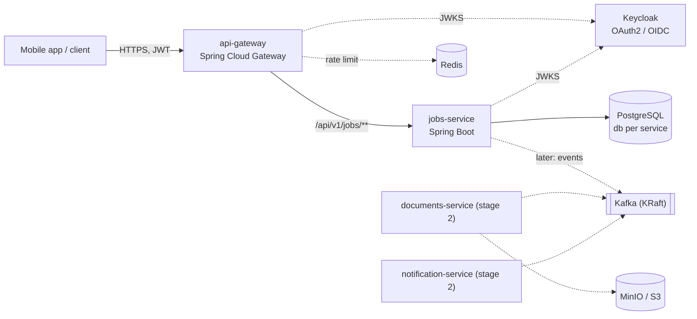

# Kajeto backend

Backend for a mobile app for tradespeople (jobs, customers, payments, receipts, offline-first sync). It is built as a production-style microservice system and doubles as a portfolio project: every decision is recorded as an [ADR](docs/adr).

> Kajeto (from "kajet", a tradesperson's job notebook) is the product name since 2026-11-15; earlier commits and ADR history use the working name "Fachowcy".

> Status: **stage 0**, the production skeleton (build, infrastructure, auth, gateway, first service, tests, CI). No business features yet.

## Architecture (C4, container level)



Dashed elements are present in `docker-compose` or planned, but not used by code yet.

## Tech stack

Java 21, Spring Boot 3.5, Spring Cloud Gateway, Spring Security (OAuth2 resource server), Spring Data JPA, Flyway, springdoc OpenAPI, PostgreSQL 16, Redis 7, Kafka (KRaft), MinIO (S3), Keycloak 26, Maven (multi-module), Jib, JUnit 5, AssertJ, Mockito, Testcontainers, ArchUnit, JaCoCo (80% line coverage enforced), Spotless (google-java-format), GitHub Actions.

## Modules

| Module | Purpose |
|---|---|
| `api-gateway` | single entry point: JWT validation, rate limiting (Redis), correlation id, routing |
| `jobs-service` | jobs domain; stage 0 has the baseline `job` table and `GET /api/v1/jobs/ping` (role `OWNER`) |
| `common-events` | event contracts shared by services (empty for now) |

## Run locally

Requirements: JDK 21+, Docker (Docker Desktop), no other tools (Maven Wrapper is included).

```bash
# 1. dev-only configuration (all values are throw-away dev credentials)
cp .env.example .env

# 2. build the code, run all tests, build Docker images
./mvnw verify
./mvnw -pl jobs-service,api-gateway -am -DskipTests package jib:dockerBuild

# 3. start infrastructure and the apps
docker compose --profile apps up -d
docker compose --profile apps ps        # wait until everything is "healthy"

# optional: Kafka UI on http://localhost:8085
docker compose --profile tools up -d kafka-ui
```

Infrastructure only (run services from the IDE): `docker compose up -d`.

| What | URL |
|---|---|
| API gateway | http://localhost:8080 |
| jobs-service (direct) | http://localhost:8081 |
| Swagger UI | http://localhost:8081/swagger-ui/index.html |
| Keycloak admin | http://localhost:8180 (admin credentials in `.env`) |
| MinIO console | http://localhost:9001 |
| Kafka UI (profile `tools`) | http://localhost:8085 |

If Maven fails with a certificate error (`PKIX path building failed`) behind a corporate proxy or antivirus on Windows, run it with `MAVEN_OPTS="-Djavax.net.ssl.trustStoreType=Windows-ROOT"`.

## Get a test token and call the API

The realm `kajeto` (dev only) has two users, both with password `dev-only-password`: `dev-owner` (role `OWNER`) and `dev-worker` (role `WORKER`).

```bash
TOKEN=$(curl -s -d grant_type=password -d client_id=kajeto-app \
  -d username=dev-owner -d password=dev-only-password \
  http://localhost:8180/realms/kajeto/protocol/openid-connect/token | jq -r .access_token)

curl -i http://localhost:8080/api/v1/jobs/ping                                   # 401
curl -i -H "Authorization: Bearer $TOKEN" http://localhost:8080/api/v1/jobs/ping  # 200 {"status":"ok",...}
```

With the `dev-worker` token the same call returns `403`.

## Quality gates

`./mvnw verify` runs unit tests (Surefire), integration tests with Testcontainers (Failsafe, needs Docker), ArchUnit architecture rules, JaCoCo (fails below 80% line coverage per module) and Spotless (formatting check; fix with `./mvnw spotless:apply`). The same command runs in CI.

## Decisions

See [docs/adr](docs/adr): 0001 architecture style, 0002 message broker, 0003 authentication, 0004 deployment, 0005 versions, 0006 data stores, 0007 repository layout, 0008 multi-tenancy, 0009 money, 0010 offline-ready data model.

## Roadmap

0 skeleton (this) · 1 jobs domain · 2 documents and notifications, outbox · 3 offline sync, Redis, resilience · 4 observability and Kubernetes · 5 workforce and reporting.
